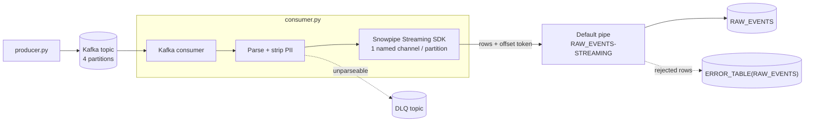

# Kafka → Snowpipe Streaming (high-performance) demo

A runnable local demo of a **custom Kafka consumer** that strips PII and streams events into Snowflake
using the **Snowpipe Streaming Python SDK** (high-performance architecture), with **exactly-once delivery
per partition**, a dead-letter queue, Snowflake error tables, crash recovery, rebalancing, and bounded replay.



## How it works

- **One named channel per Kafka partition** (`demo-events_p{N}`). The name depends only on the
  partition, so whichever instance owns a partition owns its channel, across restarts and rebalances.
- **The Kafka offset is the offset token.** Snowflake stores the latest committed token per channel.
- **Snowflake is the checkpoint.** On partition assignment the consumer reads the committed token and
  seeks Kafka to token + 1. Kafka auto-commit is off; offsets are committed back to Kafka
  asynchronously only so consumer-lag tooling works.
- **PII is removed in the app**, before data reaches Snowflake.
- **Kafka topic, partition and offset are written into every row**, which enables duplicate/gap
  checks, exact tracing of rejected rows, and targeted deletes for replay.
- **Errors have two destinations:** messages the app can't parse go to a DLQ topic; rows Snowflake
  rejects (e.g. type mismatch) go to the table's error table.

## Repository contents

| File | Purpose |
|---|---|
| `docker-compose.yml` | Single-node Kafka (KRaft) on `localhost:29092` |
| `setup.sql` | Creates `RAW_EVENTS` with `ERROR_LOGGING = TRUE`. The default pipe `RAW_EVENTS-STREAMING` is created automatically on first use. Uses `CREATE OR REPLACE` (see [Reset](#reset)) |
| `producer.py` | Generates events with PII fields and variable nested detail; `--bad-json`, `--bad-amount` |
| `consumer.py` | The consumer; `--instance`, `--crash-after N`, `--replay PARTITION:START-END` |
| `verify.sql` | Per-partition counts, duplicates, gaps, PII check, error table with exact offsets, channel history |
| `profile.json.example` | Template for the SDK connection profile |

## Prerequisites

- Docker
- [uv](https://docs.astral.sh/uv/) (installs Python dependencies: `snowpipe-streaming`, `confluent-kafka`)
- A Snowflake account and a user with **key-pair authentication**, and a role that can create the
  table in `setup.sql` and insert into it

## Setup

1. **Key pair.** Generate a key pair and register the public key on your Snowflake user
   ([docs](https://docs.snowflake.com/en/user-guide/key-pair-auth)).
2. **Profile.** Copy `profile.json.example` to `profile.json` and fill in your account, user, role and
   the absolute path to your private key. `profile.json` and key files are git-ignored.
3. **Snowflake objects.** Run `setup.sql` (creates database `SNOWPIPE_STREAMING`, schema `PUBLIC`,
   table `RAW_EVENTS`). The consumer's target is set in the `StreamingIngestClient.from_table(...)` call in `consumer.py`.
4. **Kafka and dependencies.**
   ```bash
   docker compose up -d
   docker exec ssv2-kafka /opt/kafka/bin/kafka-topics.sh --bootstrap-server localhost:29092 \
     --create --if-not-exists --topic demo-events --partitions 4
   docker exec ssv2-kafka /opt/kafka/bin/kafka-topics.sh --bootstrap-server localhost:29092 \
     --create --if-not-exists --topic demo-events-dlq --partitions 1
   uv sync
   ```

## Demo scenarios

### 1. Happy path, DLQ and error table
```bash
# Terminal 1: consumer
uv run python consumer.py --instance a

# Terminal 2 (optional): watch only NEW DLQ messages
docker exec -it ssv2-kafka /opt/kafka/bin/kafka-console-consumer.sh --bootstrap-server localhost:29092 \
  --topic demo-events-dlq --property print.headers=true --property print.offset=true

# Terminal 3: traffic
uv run python producer.py --count 2000 --rate 400   # good events
uv run python producer.py --count 3 --bad-json      # -> DLQ
uv run python producer.py --count 3 --bad-amount    # -> error table
```
`--rate` is a target events/sec (`0` = unthrottled). For scale: 10M events/day ≈ 115 events/sec.

The consumer logs per-channel status every 10 seconds:
```
[consumer-a] p3: status=SUCCESS committed=479 inserted=480 errors=0
```
Counters are cumulative for the channel. `committed` is the last committed Kafka offset; offsets that
went to the DLQ or error table advance it without being inserted.

### 2. Crash and recovery
Stop the running consumer first, so the crash instance owns every partition:
```bash
pkill -INT -f "consumer.py --instance a"                   # graceful: flush + close channels
uv run python producer.py --count 3000 --rate 0            # backlog, so >800 rows are buffered
uv run python consumer.py --instance a --crash-after 800   # hard kill, buffered rows lost
uv run python consumer.py --instance a                     # logs: committed=X -> seek X+1
```
The lost rows are re-read from Kafka. `verify.sql` shows no duplicates and no gaps beyond the
DLQ/error-table offsets.

`seek -2` in the log is Kafka's `OFFSET_BEGINNING`: the channel had no committed token, so the
consumer starts from the earliest retained offset.

### 3. Rebalance
With instance `a` running, start a second instance in another terminal:
```bash
uv run python consumer.py --instance b
```
Partitions are split between the instances. Each newly assigned partition resumes from the token
the previous owner committed.

### 4. Bounded replay
Reprocess specific offset ranges, e.g. after fixing the PII-stripping logic, while the live consumer
keeps running. This example reprocesses partition 0 offsets 1200–1500 and partition 3 offsets 980–1100.

First delete exactly those ranges in Snowflake:
```sql
DELETE FROM SNOWPIPE_STREAMING.PUBLIC.RAW_EVENTS
WHERE (KAFKA_PARTITION = 0 AND KAFKA_OFFSET BETWEEN 1200 AND 1500)
   OR (KAFKA_PARTITION = 3 AND KAFKA_OFFSET BETWEEN 980 AND 1100);
```
Then replay the same ranges:
```bash
uv run python consumer.py --instance replay1 --replay 0:1200-1500 --replay 3:980-1100
```
- Ranges are per partition and inclusive; repeat `--replay` per partition.
- The replay uses its own consumer group with `assign()` (no rebalance of the live group) and its own
  channels (`..._replay_<instance>_p<N>`). Reusing the live channel names would supersede the live
  consumer's channels (HTTP 409).
- It validates ranges against Kafka retention, stops each partition at its end offset, resumes from
  its own token if it crashes, waits for the final commit, then drops its channels and exits.
- Delete the range first, or the duplicate check flags every replayed offset. Bad messages in the
  range are sent to the DLQ again.

## Verification

Run `verify.sql`:

1. Rows per partition and instance
2. Duplicates by (partition, offset), expected zero
3. Offset gaps, expected only DLQ and rejected offsets
4. PII check, expected zero
5. Rejected rows, with the exact Kafka offset parsed from the original row
6. Channel history from `SNOWFLAKE.ACCOUNT_USAGE.SNOWPIPE_STREAMING_CHANNEL_HISTORY`

Example reconciliation from one run, including a hard crash with 800 unflushed rows and a two-instance rebalance:

| | Kafka records | RAW_EVENTS | Error table | DLQ | Duplicates |
|---|---|---|---|---|---|
| Total | 5,006 | 5,000 | 3 | 3 | 0 |

## Observed SDK and platform behavior (SDK v1.9.0)

- **Rejected rows don't fail the append.** `status_code` stays `SUCCESS`. The signals are
  `ChannelStatus.rows_error_count` and the error table. Errors arrive asynchronously, a few seconds
  after the append, when the app polls channel status.
- **Rejected rows advance the committed token**, so a restart doesn't retry them; fix and reload them
  from the error table.
- **Error-table offset bounds are per batch.** `offset_token_lower_bound`/`upper_bound` describe the
  batch the bad row arrived in. The exact offset is in the original row, stored as a JSON string in
  `ERROR_DATA:"$1"`; `verify.sql` parses it.
- **Channel state belongs to the pipe instance.** Recreating the table recreates the default pipe
  (new `PIPE_ID`, same name) and wipes every committed token. Running consumers fail with
  `ERR_PIPE_DOES_NOT_EXIST_OR_NOT_AUTHORIZED`; a restarted consumer finds no tokens and replays the
  whole topic.
- **Fencing:** per the docs, reopening a named channel supersedes the previous owner, which receives
  HTTP 409 and must reopen and resume from the last committed offset.
- **`SHOW CHANNELS` returns nothing** for these channels. Live state comes from the SDK
  (`get_channel_status`, `get_channel_statuses`). The `ACCOUNT_USAGE` channel history view is delayed
  and appears to record only error events.
- **`get_channel_status()` takes about 1.2 s per call** and blocks the poll loop. Production code should
  batch with `client.get_channel_statuses([...])` or poll from a separate thread.

## Reset

Reset Kafka and Snowflake **together**. Resetting only Snowflake makes the consumer replay the whole
topic (and re-send old bad messages to the DLQ). Resetting only Kafka leaves channel tokens pointing at
offsets that no longer exist.
```bash
pkill -INT -f consumer.py
docker compose down -v && docker compose up -d   # then recreate both topics (see Setup)
```
Then re-run `setup.sql`. Recreating the table also recreates the pipe, which clears all channel tokens.
To keep the table instead: `TRUNCATE TABLE` plus `client.drop_channel("demo-events_pN")` for
each partition.

## Not covered

This is a demo, not production code. It doesn't implement:
- backpressure (`consumer.pause()` when Snowflake is unavailable)
- recovery from mid-stream channel (409) or client invalidation
- a guard against replaying from the beginning when no token exists
- cooperative-sticky rebalancing
- DLQ delivery callbacks and DLQ dedup
- an allowlist-based PII scrubber (it removes three fixed top-level fields)
- secrets management for the private key
- PrivateLink

## References

- [Snowpipe Streaming high-performance architecture](https://docs.snowflake.com/en/user-guide/snowpipe-streaming/snowpipe-streaming-high-performance-overview)
- [Best practices](https://docs.snowflake.com/en/user-guide/snowpipe-streaming/snowpipe-streaming-high-performance-best-practices)
- [Error handling](https://docs.snowflake.com/en/user-guide/snowpipe-streaming/snowpipe-streaming-high-performance-error-handling)
- [Python SDK reference](https://docs.snowflake.com/en/user-guide/snowpipe-streaming-sdk-python/reference/latest/index)

---

_Built with the help of [Snowflake Cortex Code](https://docs.snowflake.com/en/user-guide/cortex-code/cortex-code)._
